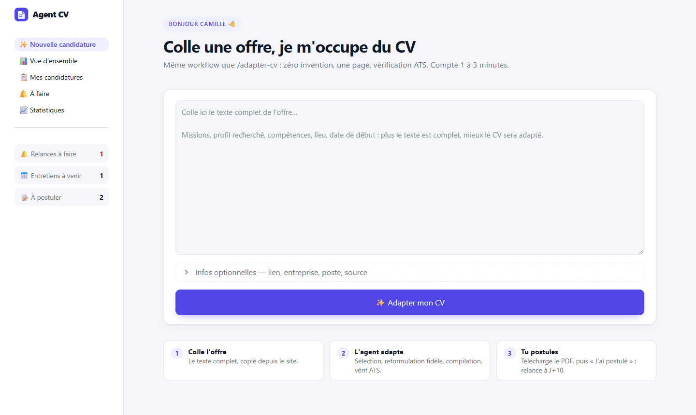
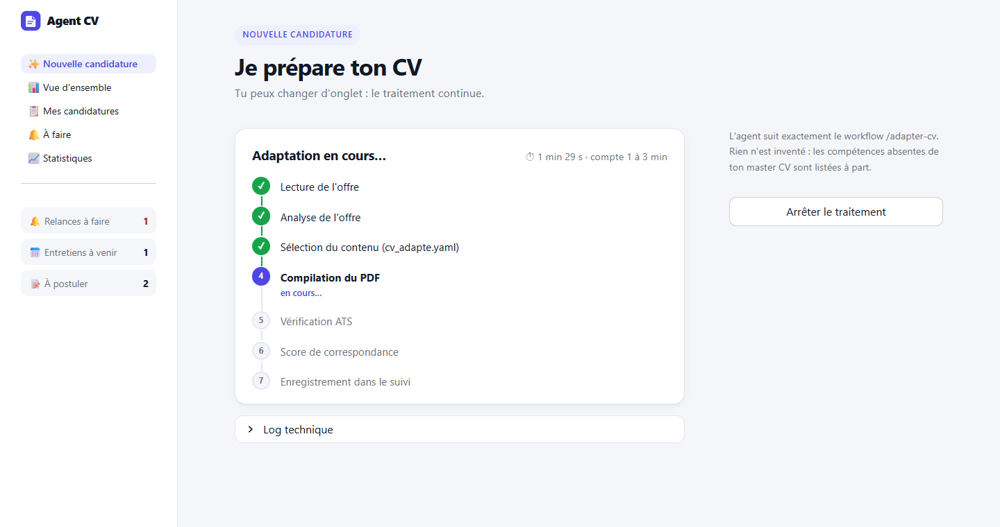
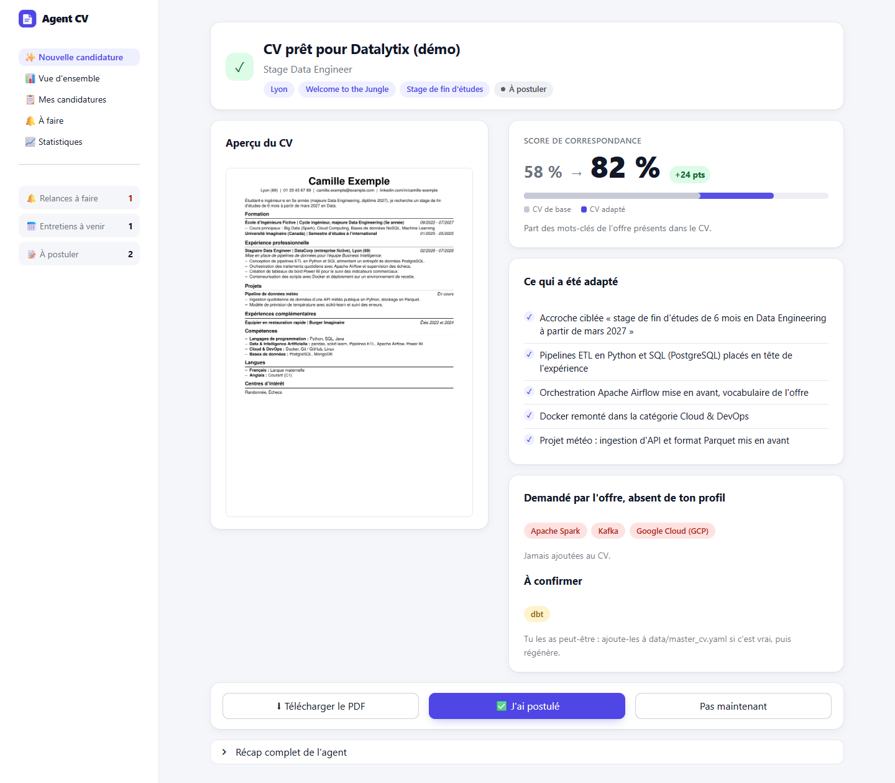
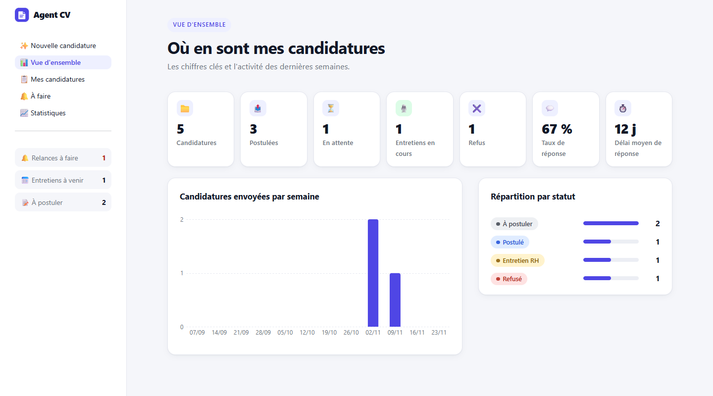
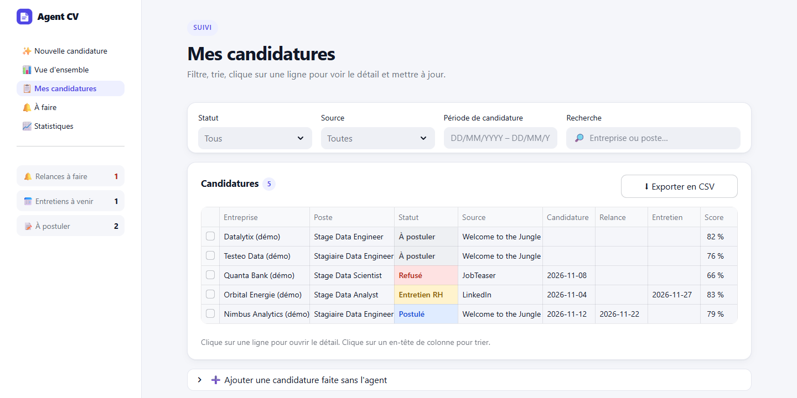
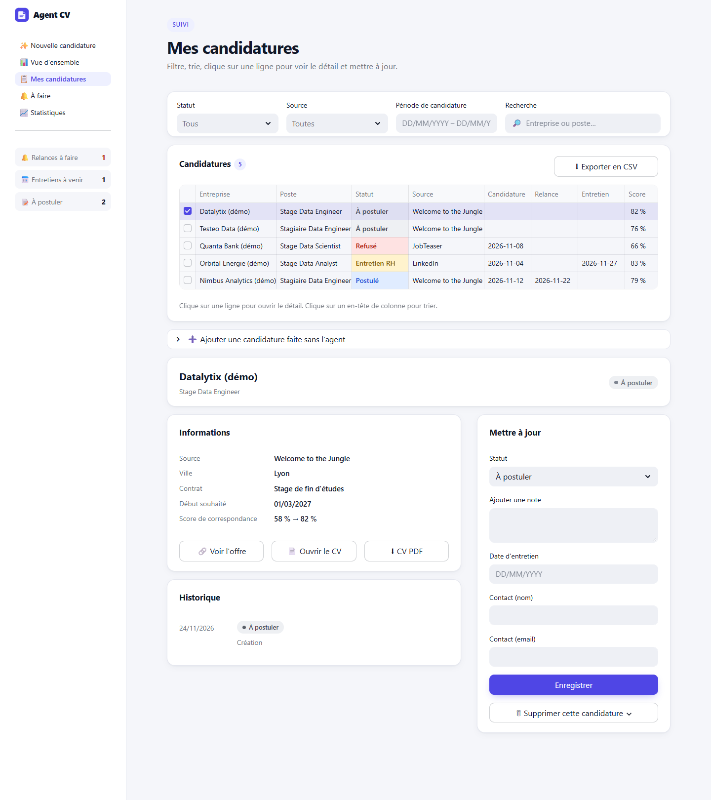
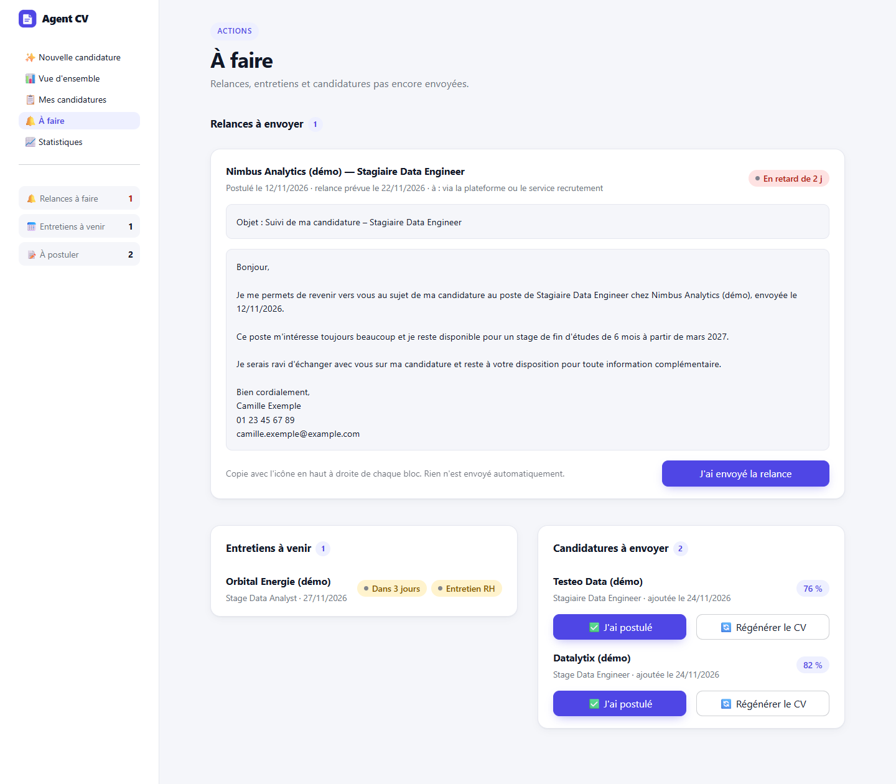
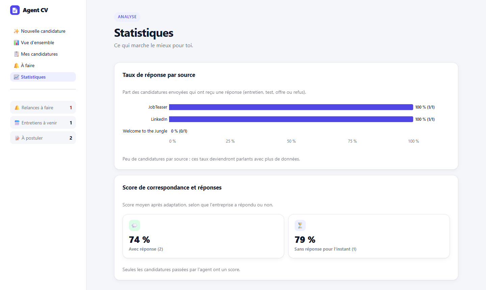

# Agent CV

Projet perso de **Mathieu Gasnier** (EFREI Paris, majeure Data Engineering) :
un agent basé sur [Claude Code](https://claude.com/claude-code) qui adapte
mon CV à chaque offre de stage et suit toutes mes candidatures dans un
dashboard local.

- **CV 100 % lisible par les ATS** : LaTeX une colonne, sans photo, sans icône,
  texte extractible proprement, vérifié automatiquement.
- **Adaptation à une offre en 1 à 3 minutes** : l'agent analyse l'offre,
  sélectionne et reformule le contenu de mon CV maître, compile le PDF et
  mesure le gain de correspondance avec les mots-clés de l'offre.
- **Règle n°1 : zéro invention.** Une compétence demandée que je n'ai pas
  n'est jamais ajoutée au CV, elle est listée à part.
- **Suivi des candidatures** : statuts, relances automatiques à J+10,
  historique, statistiques par source.

> Les captures ci-dessous utilisent un profil **fictif** (« Camille Exemple »)
> et des entreprises de démo.

## Aperçu

**Coller une offre, lancer l'adaptation**



**Suivi en direct du workflow**



**Résultat : aperçu du CV, score de correspondance, modifications, compétences manquantes**



<details>
<summary><b>Les autres onglets</b> (vue d'ensemble, suivi, à faire, statistiques)</summary>







</details>

## Comment ça marche

```
data/master_cv.yaml ──► /adapter-cv <offre> ──► offres/<date>_<entreprise>_<poste>/
 (réservoir complet,      1. analyse de l'offre          analyse.md, keywords.txt
  bilingue FR/EN)         2. sélection + reformulation   cv_adapte.yaml
                          3. compilation LaTeX           Prenom_Nom_CV_<Entreprise>.pdf
                          4. vérification ATS            (ats_check.py)
                          5. score de correspondance     score.json (keyword_score.py)
                          6. ajout au suivi              data/candidatures.db
```

Le dashboard lance exactement le même workflow en arrière-plan
(`claude -p "/adapter-cv ..."`), avec des permissions limitées : lecture du
projet, écriture uniquement dans `offres/`, et seulement les scripts du projet.

## Installation (Windows)

1. **Prérequis**
   - Python 3.11+
   - [MiKTeX](https://miktex.org/) (`pdflatex`) et [Poppler](https://github.com/oschwartz10612/poppler-windows) (`pdftotext`, `pdftoppm`) :
     `winget install MiKTeX.MiKTeX` puis `winget install oschwartz10612.Poppler`
   - [Claude Code](https://claude.com/claude-code), connecté à ton compte
2. **Dépendances Python**
   ```
   python -m pip install -r requirements.txt
   ```
3. **Ton profil** : copie `data/master_cv.example.yaml` en
   `data/master_cv.yaml` et remplace tout par tes vraies informations. Ce
   fichier est ignoré par git.
4. **CV de base** : dans Claude Code, lance `/build-cv`.

Les scripts trouvent `pdflatex`, `pdftotext` et Claude Code tout seuls, même si
le PATH n'est pas à jour (`scripts/_tools.py`, `dashboard/claude_runner.py`).

## Utilisation

### Dashboard

Double-clic sur **`Lancer_Dashboard.bat`** : le dashboard démarre et le
navigateur s'ouvre sur http://localhost:8501. Fermer la fenêtre noire arrête
le dashboard.

| Onglet | Rôle |
|---|---|
| Nouvelle candidature | Coller une offre → CV adapté, score, compétences manquantes, « J'ai postulé » |
| Vue d'ensemble | Chiffres clés, candidatures par semaine, répartition par statut |
| Mes candidatures | Tableau filtrable, détail, historique, mise à jour, export CSV |
| À faire | Relances (mail proposé, jamais envoyé), entretiens, CV à envoyer |
| Statistiques | Taux de réponse par source, score moyen avec / sans réponse |

### Commandes Claude Code

| Commande | Effet |
|---|---|
| `/build-cv` | Génère le CV de base depuis `data/master_cv.yaml` |
| `/adapter-cv <texte \| URL \| PDF>` | Adapte le CV à une offre et l'ajoute au suivi |
| `/postule <entreprise>` | Passe en « Postulé », relance prévue à J+10 |
| `/statut <entreprise> <statut> [note]` | Change le statut (entretien, refus…) |
| `/ajout-candidature` | Ajoute une candidature faite sans l'agent |
| `/relances` | Relances du jour + mail de relance à copier-coller |
| `/bilan` | Résumé : taux de réponse, entretiens, prochaines actions |

### Statuts et règles

`À postuler` → `Postulé` → `Relancé` → `Entretien RH` → `Test technique` →
`Entretien technique` → `Offre reçue` → `Acceptée`, et à tout moment
`Refusé`, `Sans réponse` ou `Abandonné`.

- Passage en `Postulé` : une relance est prévue à J+10 (une seule relance).
- `Postulé` ou `Relancé` depuis plus de 30 jours sans nouvelle :
  passage automatique en `Sans réponse`, noté dans l'historique.

## Structure

```
data/master_cv.example.yaml   profil fictif (le vrai master_cv.yaml est ignoré par git)
templates/cv_template.tex     template LaTeX ATS (Jinja2)
scripts/build.py              yaml -> tex -> pdf
scripts/ats_check.py          vérifie la lisibilité ATS d'un PDF
scripts/keyword_score.py      score de correspondance mots-clés offre <-> CV
scripts/candidatures.py       suivi des candidatures (SQLite) : module + CLI
dashboard/                    dashboard Streamlit (app, onglets, style, lancement headless)
.claude/commands/             commandes Claude Code (/adapter-cv, /postule, ...)
tests/                        tests unitaires
Lancer_Dashboard.bat          lanceur à double-cliquer
```

## Confidentialité

Le dépôt ne contient aucune donnée personnelle : le CV maître, les offres,
les PDF générés, la base de candidatures et les sources (rapport de stage)
sont exclus par le `.gitignore`. Aucune coordonnée n'est écrite en dur dans le
code : tout est lu dans le CV maître.

## Tests

```
python -m unittest discover -s tests
```
